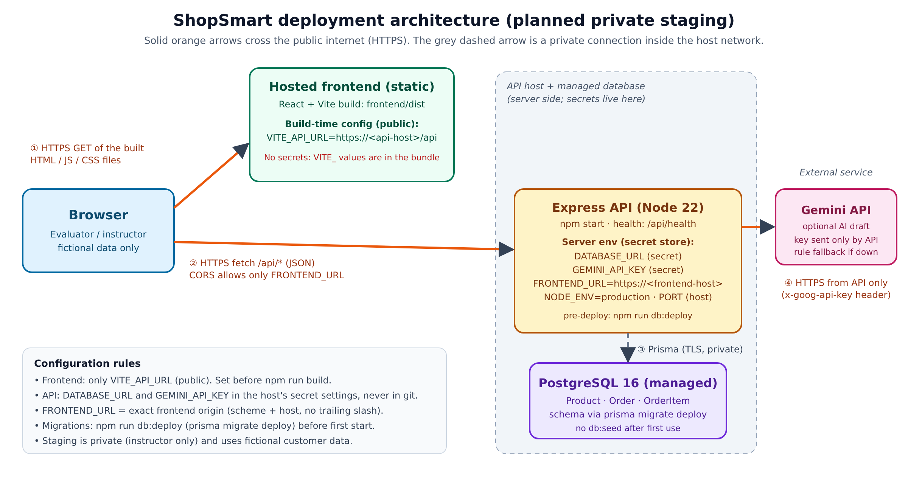

# PDC50 Final Laboratory — ShopSmart Quality and Deployment

Student: Yoj T. Cuison · Branch: `ASC_AI_ASSISTANT_SHOPSMART_CUISON` · Starting commit: `21b7734`
Release type: **local release candidate only (no live staging was approved or deployed).**

Screenshots are in `docs/lab6_screenshots/`. Files `01`–`26` were captured on the Linux test machine on 2026-11-11 (Asia/Manila) with PostgreSQL 16, Node 22 and no Gemini key. Files named `PC_*` were captured on my own Windows PC.

## 1. Baseline and feature inventory

| Item | Result |
| --- | --- |
| `npm run check` before any change | Passed: frontend and backend lint, 11 frontend tests, 27 backend tests, production build (`01_baseline_npm_run_check.png`) |
| `/api/health` | `{"status":"ok"}` (`03_api_health.png`) |
| Product catalog, server-side search, category filter, sort | Present |
| Cart (add, quantity +/−, remove, stock limit) | Present; in memory only (cleared on refresh) |
| Simulated checkout with server-side prices and stock decrement | Present |
| Grounded assistant (catalog retrieval, Gemini draft, verifier, rule fallback) | Present |
| Live AI (Gemini) | **Present**, server-side, optional (`GEMINI_API_KEY` in `backend/.env`) |
| Authentication and roles | **Absent**: no sign-in, no order history route, so the guest/owner/other-customer tests do not apply |

## 2. Test record

Test data is fictional: Juan Dela Cruz, juan.delacruz@example.com, 123 Sample St, Angeles City. The database was seeded once at the start; it was not reseeded during verification.

| # | Case and starting state | Action and test data | Expected result | Observed result and evidence | Decision |
| --- | --- | --- | --- | --- | --- |
| T1 | Browse: seeded catalog, API running | Open http://localhost:5173 | Six product cards with price and stock | Six cards shown (`04_products_page.png`) | Pass |
| T2 | Search: catalog loaded | Type `keyboard` | Only the keyboard is shown | Only Compact Mechanical Keyboard (`05_search_keyboard.png`) | Pass |
| T3 | Search no results | Type `running shoes` | Clear no-results message, no crash | `No products match "running shoes".` (`06_search_no_results.png`) | Pass |
| T4 | Search wildcard | `GET /api/products?search=%` | Only products containing `%` (none) | **6 products returned**, `%` acted as a SQL wildcard (`22_…before_after.png`) | Fail → D4, retest pass |
| T5 | Cart add: empty cart | Add Wireless Mouse (₱650) and 1080p Webcam (₱1,450) | 2 items, total ₱2,100 | Items 2, total ₱2,100 (`07_cart_two_items.png`) | Pass |
| T6 | Cart quantity | Press + on Wireless Mouse | 3 items, total ₱2,750 | Items 3, total ₱2,750 (`08_cart_quantity_increased.png`) | Pass |
| T7 | Cart remove | Remove 1080p Webcam | 2 mice, total ₱1,300 | Total ₱1,300 (`09_cart_item_removed.png`) | Pass |
| T8 | Cart refresh | Reload the cart page | Team design: cart is in memory | Cart empty after refresh (`10_cart_after_refresh.png`) | Pass as designed; listed as a limitation |
| T9 | Stock in cart: webcam stock 6 | Type quantity 11 | Refused, quantity unchanged | "Only 6 unit(s) are available.", quantity stays 1 (`11_stock_limit_cart.png`) | Pass |
| T10 | Stock in API: webcam stock 6, 3 orders | `POST /api/orders` with webcam quantity 11 | 409, no order created, stock unchanged | 409 `INSUFFICIENT_STOCK`; stock 6 and 3 orders before and after (`11b_stock_api_409.png`) | Pass |
| T11 | Checkout invalid: 1 item in cart | Name `  A  `, address `  short   ` | Refused with a clear reason | Before fix: refused but only "Check the customer and cart information." (`12_…before.png`) | Fail → D3, retest pass (`13_…after.png`) |
| T12 | Checkout valid: mouse + keyboard (₱2,500) | Fictional details, Place simulated order | One order, total from server | Order #4, total ₱2,500.00 (`14a`, `14b`); one Order row with two OrderItems at catalog prices (`15_order_saved_in_db.png`) | Pass |
| T13 | Assistant match | "Which keyboard is below ₱2,000?" | Keyboard ₱1,850 with source link | Compact Mechanical Keyboard ₱1,850, source Product #2, link opens the product (`16`, `16b`) | Pass |
| T14 | Assistant no match | "Do you sell running shoes?" | Honest no-match, no products or sources | "I could not find an in-stock ShopSmart product…", 0 sources (`17_assistant_no_match.png`) | Pass |
| T15 | AI provider failure | API started with `GEMINI_API_KEY=test-key-not-real`, `GEMINI_BASE_URL=http://127.0.0.1:9` | Loading ends, rule answer with a notice | Notice "The AI service is unavailable right now…", USB Headset ₱1,350 from the catalog (`18_assistant_provider_failure.png`) | Pass |
| T16 | API down at checkout | Stop the API, Place simulated order | Loading ends, useful message, cart kept | Before fix: **"Failed to fetch"** (`19_checkout_api_down_before.png`) | Fail → D1, retest pass (`20_…after.png`) |
| T17 | API down elsewhere | Products, product details, assistant with API stopped | Readable message on each page | After fix: same readable message on all three (`21`, `21b`, `21c`) | Pass after D1 |
| T18 | Malformed JSON / oversized body | `POST /api/orders -d '{bad'`; 200 kB question | 400 / 413 with a client error code | Before fix: code `INTERNAL_ERROR` and the raw parser text (`22_…before_after.png`) | Fail → D2, retest pass |
| T19 | Data survival | Count rows before and after the smoke test | Earlier orders still present | 3 orders before, 4 after (the new order), products 6 (`02`, `25`) | Pass |
| T20 | Secrets | `git ls-files`, git history, `frontend/dist` | No `.env`, key or DATABASE_URL committed or bundled | Only `.env.example` tracked; 0 keys in history; no secrets in bundle (`24_secret_checks.png`) | Pass |
| T21 | Live Gemini (my PC) | Real key, "Which keyboard is below ₱2,000?" | Badge "AI draft · checked against the catalog" | See `PC_03_live_gemini_answer.png` | Pass when captured |

## 3. Defects, diagnosis and fixes

| ID | Reproduction (start → action → actual → expected) | Smallest underlying cause | Fix | Regression test |
| --- | --- | --- | --- | --- |
| D1 (checkout) | Item in cart, API stopped → Place simulated order → "Failed to fetch" → a message saying the server cannot be reached | `fetch()` rejects with the browser's `TypeError`; `api.js` re-threw it, so each page showed the raw text | `frontend/src/services/api.js` turns a network failure into one readable `NETWORK_ERROR` message; Products and Assistant pages use it (no duplicated text). The cart is kept. | `frontend/src/services/api.test.js` (3 tests) |
| D2 (API) | `POST /api/orders` with `{bad` → 400 with `INTERNAL_ERROR` and the parser message; 200 kB body → 413 `INTERNAL_ERROR` → stable client codes | The error handler used `error.code \|\| 'INTERNAL_ERROR'` and exposed `error.message` for any status; body-parser errors carry `type`, not `code`. The request ID was assigned after body parsing. | New `backend/src/middleware/errorHandler.js`: `INVALID_JSON` (400) and `PAYLOAD_TOO_LARGE` (413) with fixed messages; 5xx stays generic; request ID now assigned before parsing so every error has a trace ID | `backend/test/errorHandler.test.js` (4 tests) |
| D3 (checkout) | Name `  A  ` → submit → "Check the customer and cart information." only → the rejected field is named | The API returns `details.fieldErrors` but `api.js` dropped them and checkout showed only the summary | `api.js` keeps `details`; `frontend/src/utils/orderErrors.js` turns field errors into plain sentences; CheckoutPage lists them | `frontend/src/utils/orderErrors.test.js` (2 tests) |
| D4 (search) | `?search=%` → all 6 products → none | Prisma `contains` is sent to PostgreSQL `LIKE` without escaping `%` and `_` | `escapeLikePattern()` in `backend/src/services/productSearch.js` | New test in `backend/test/productSearch.test.js` |

No test was deleted or weakened. After the fixes `npm run check` passes with 16 frontend and 32 backend tests (`23_npm_run_check_final.png`).

### Unresolved items (known limitations)

- **Cart is not persisted.** A refresh empties the cart. Impact: the user re-adds items; no wrong order can result because prices and stock are checked by the API. Safe limitation: finish checkout without refreshing.
- **No authentication or roles.** There is no order-history route, so customer data cannot be read back through the API, but anyone who can open the site can place simulated orders. Safe limitation: keep any staging private and use fictional data only.
- **Assistant recall.** "best item for studying" returns an honest no-match because "studying" does not match the Study category. It never recommends a wrong product. Rephrase as "study lamp" or "laptop stand".
- **`npm run db:seed` deletes all orders.** It must not be run against a database with work to keep.
- `/api/health` reports that the API process is running; it does not check the database connection.

## 4. Deployment plan

The class has not approved a hosting platform, so the plan names roles rather than one provider. Platform commands must be checked against that platform's current documentation.

| Question | Plan |
| --- | --- |
| Where are the Vite build files hosted, and which API URL do they use? | A static site host serves `frontend/dist`. Build command: `npm ci && npm run build` with `VITE_API_URL=https://<api-host>/api` set in the host's build settings. `VITE_` values are public and compiled into the bundle, so only the API URL goes there. |
| Where does Express run, and which public URL serves `/api/health`? | A Node 22 web service (`.nvmrc`). Build: `npm ci && npm run db:generate`. Start: `npm start` (runs `node src/server.js` in `backend`). The host sets `PORT`. Health check: `https://<api-host>/api/health`. |
| Where does PostgreSQL run, and how does the server get `DATABASE_URL`? | A managed PostgreSQL 16 instance in the same provider or region. Its connection string, with TLS (`sslmode=require`), is pasted into the API service's secret environment settings as `DATABASE_URL`. It is never committed, never in a `VITE_` variable and never in screenshots. |
| Which origin is allowed by `FRONTEND_URL` and CORS? | Exactly the static site origin, e.g. `FRONTEND_URL=https://<frontend-host>` (scheme and host, no path, no trailing slash). `app.js` passes it to `cors({ origin })`, so other sites cannot call the API from a browser. |
| Where is the provider key stored? | `GEMINI_API_KEY` (and optional `GEMINI_MODEL`, `GEMINI_TIMEOUT_MS`) in the API service's secret settings only. `.env` is in `.gitignore`; the key is sent only in the `x-goog-api-key` header from the server. With no key the assistant uses rule answers. |
| How are migrations applied without wiping orders? | `npm run db:deploy` (new script → `prisma migrate deploy`) as the pre-deploy/release step. It only applies committed migrations in `backend/prisma/migrations` and never resets data. `npm run db:migrate` (`migrate dev`) is for local development only. `npm run db:seed` may run **once** on a new empty database to add the fictional products, and never afterwards. |
| Who can access staging, and what data is used? | The instructor only, via an unlisted URL or the host's access protection, for the grading period, then shut down. Only fictional products and customers. There is no sign-in, so staging must not be public and must not collect real personal data. |

Release order: (1) create the database; (2) deploy the API with its secrets, pre-deploy `npm run db:deploy`; (3) check `https://<api-host>/api/health`; (4) build the frontend with `VITE_API_URL`; (5) set `FRONTEND_URL` to the frontend origin and restart the API; (6) run the smoke test below with fictional data.

## 5. Release candidate verification (local)

| Release check | Result |
| --- | --- |
| Build and tests | `npm run check` exit code 0 (`23`, and `PC_01` on my PC) |
| Health and API | `/api/health` → `{"status":"ok"}`; the frontend reached `http://localhost:3000/api` (`03`, `04`) |
| Database | Products load; order #4 placed; earlier orders 1–3 still present; no reseed (`02`, `14b`, `15`, `25`) |
| Assistant | Grounded answer with sources (`16`); honest no-match (`17`); provider outage gives a rule answer with a notice (`18`) |
| Secrets | No `.env`, `DATABASE_URL` or key committed or in `frontend/dist` (`24`) |
| Privacy | Only fictional customer details were used |

## 6. Release note

- **Version and date:** branch `ASC_AI_ASSISTANT_SHOPSMART_CUISON`, Lab 6 commit on top of `21b7734`, 2026-11-11.
- **Working features:** product browsing and server-side search; category and sort; cart add, change quantity and remove with stock limits; simulated checkout with server-side prices, stock decrement and validation; grounded product assistant with Gemini draft, verification and rule fallback; readable errors when the API or AI provider is unavailable.
- **Fixed in this release:** D1 readable network errors; D2 `INVALID_JSON` / `PAYLOAD_TOO_LARGE` client errors with trace IDs; D3 field-level checkout errors; D4 literal `%`/`_` search. Added `npm run db:deploy` and `npm start` at the root.
- **Known limitations:** no authentication or roles; cart not persisted across refresh; assistant may miss word variants such as "studying"; `db:seed` resets orders; health check does not test the database.
- **Local startup:** follow `README.md` steps 1–11 (create `backend/.env` and `frontend/.env` from the examples, `npm install`, `npm run db:generate`, `npm run db:migrate`, `npm run db:seed` once, `npm run check`, `npm run dev`). Optional: add `GEMINI_API_KEY` to `backend/.env` for live AI drafts.
- **Deployment status:** **local release candidate only.** No private staging or live site was deployed because no hosting was approved.
- **Team record (individual submission, Yoj T. Cuison):**
  - *Test I ran:* T16, the checkout with the API stopped (`19_checkout_api_down_before.png` → `20_checkout_api_down_after.png`).
  - *Contribution:* baseline and feature inventory, the full test record (T1–T21), fixes D1–D4 with 10 new regression tests, the deployment diagram and plan, and this release note.
  - *Issue I can explain:* D1. `fetch()` rejects with a `TypeError` ("Failed to fetch") when no server answers, before any HTTP status exists. `api.js` re-threw it unchanged, so checkout showed the browser's wording. The fix catches the network failure once in `request()` and throws one readable `NETWORK_ERROR` message, so every page benefits and the cart is kept for a retry.
