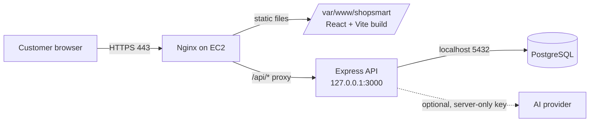

# Decision Record: Single EC2 Host

**Status:** accepted · **Date:** 2026-11-20 · **Scope:** short classroom demonstration with fictional data

## Decision

Run the built React frontend, the Express API and PostgreSQL on **one EC2 instance**, with **Nginx** as the only public entry point on HTTPS.

## Why

- **One HTTPS origin.** Nginx serves the frontend and forwards `/api/` to Express, so the browser talks to one address. This avoids mixed-content blocking, cross-origin cookie problems and most CORS issues for sign-in.
- **Fewer services to configure and pay for.** One instance, one volume and one Elastic IP fit comfortably in the Free plan credits for a few weeks.
- **The database is never public.** PostgreSQL listens on localhost only; Express listens on `127.0.0.1:3000` only.

## Trade-offs we accept

- **Single point of failure.** If the instance stops, the site, API and database are all down.
- **We own operations:** OS updates, the `shopsmart-api` service, database backups (`03-backup.sh`), certificate renewal and cleanup.
- **Data lives on the instance volume.** Terminating the instance deletes the database unless it was backed up.

## What would change for a real release

Move to **Amplify Hosting (frontend) + EC2 or a container service (API) + private RDS PostgreSQL** with automated backups, an HTTPS API domain, AWS Secrets Manager for server secrets, multiple Availability Zones, monitoring alarms and real payment/identity providers.

## Architecture

Request trace: the browser asks `/api/products` → Nginx forwards to Express → Express reads PostgreSQL → React renders the products. For an assistant question, Express first selects in-stock catalog products, then (optionally) asks the provider and validates the reply against those records.

## Ports

| Port | Exposure | Purpose |
| --- | --- | --- |
| 443 | Public | Website and API over HTTPS |
| 80 | Public | Redirects to HTTPS; Let's Encrypt validation |
| 22 | Team IP / EC2 Instance Connect only | Administration |
| 3000 | Internal (127.0.0.1) | Express, reached only through Nginx |
| 5432 | Internal (localhost) | PostgreSQL, reached only by Express |

## Two kinds of identity

- **AWS IAM / project access** decides who may manage AWS resources (the team).
- **ShopSmart customer accounts** (`/api/auth/*`) identify shoppers. The Express API decides whether a signed-in customer may read an order: `GET /api/orders/:id` only returns orders whose `userId` matches the session. Giving a teammate AWS access does not give them access to customer orders, and vice versa.

## Secrets

`DATABASE_URL`, `SESSION_SECRET` and `GEMINI_API_KEY` exist only in `/etc/shopsmart/backend.env` on the server (chmod 600). The only build-time public value is `VITE_API_URL=/api`.
